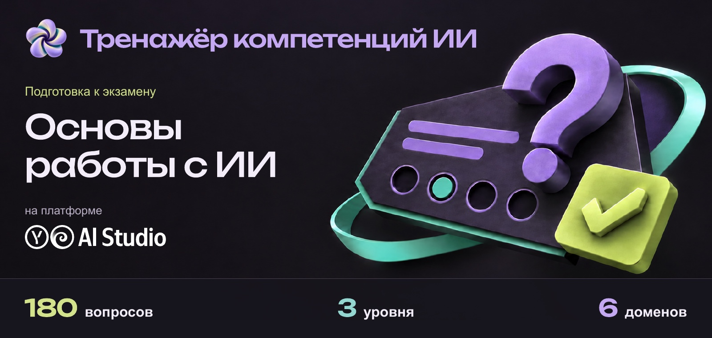
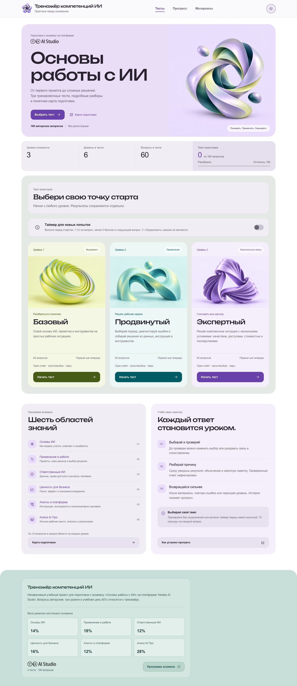
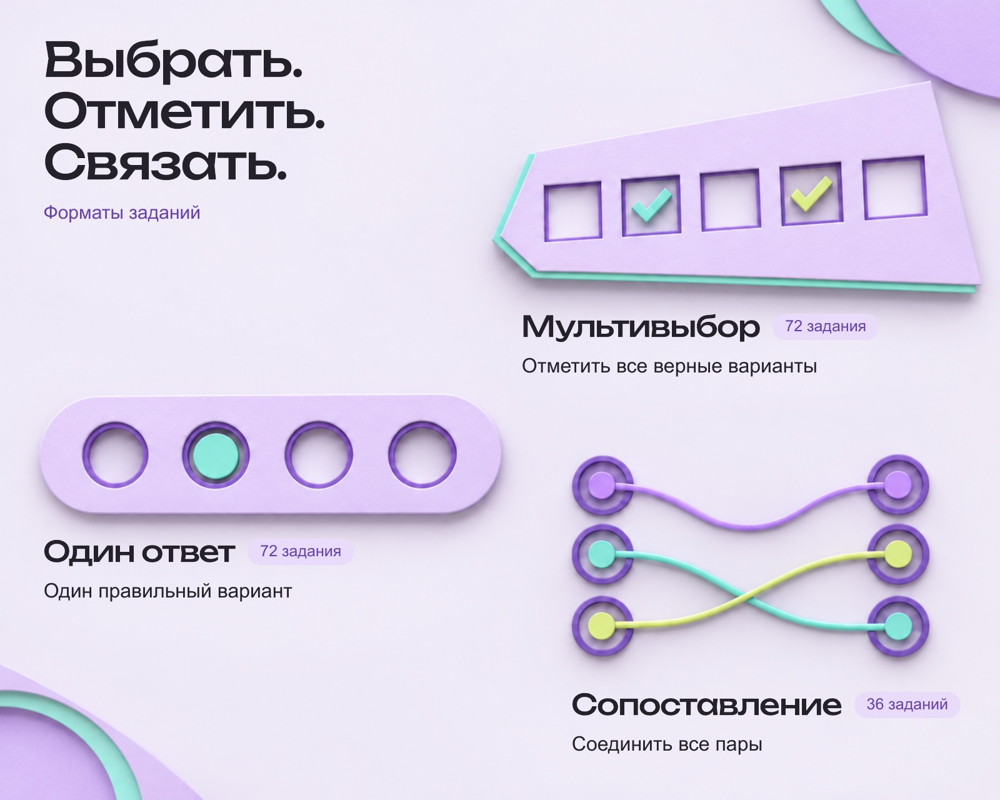
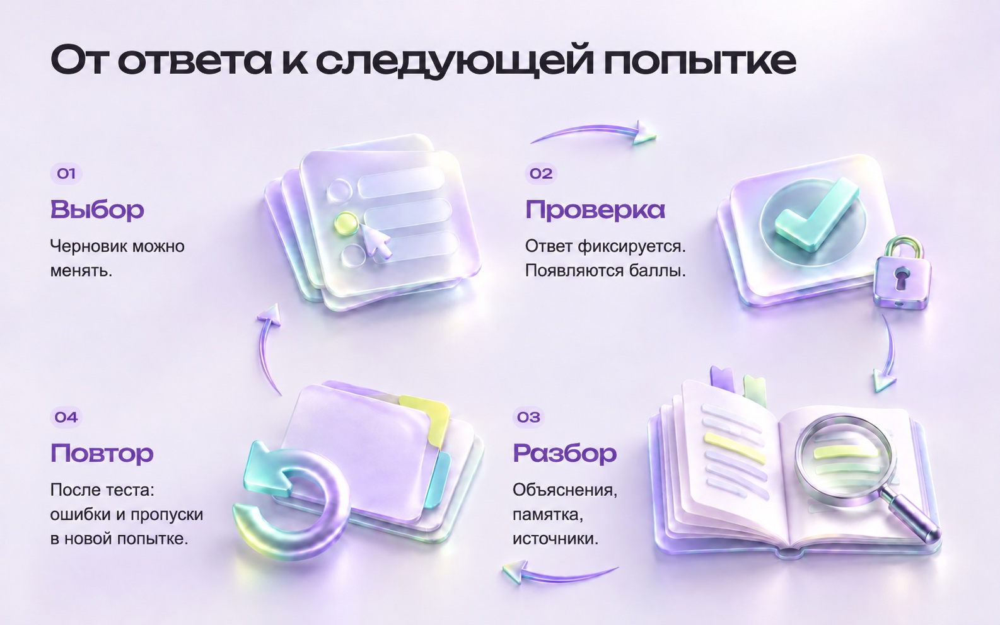
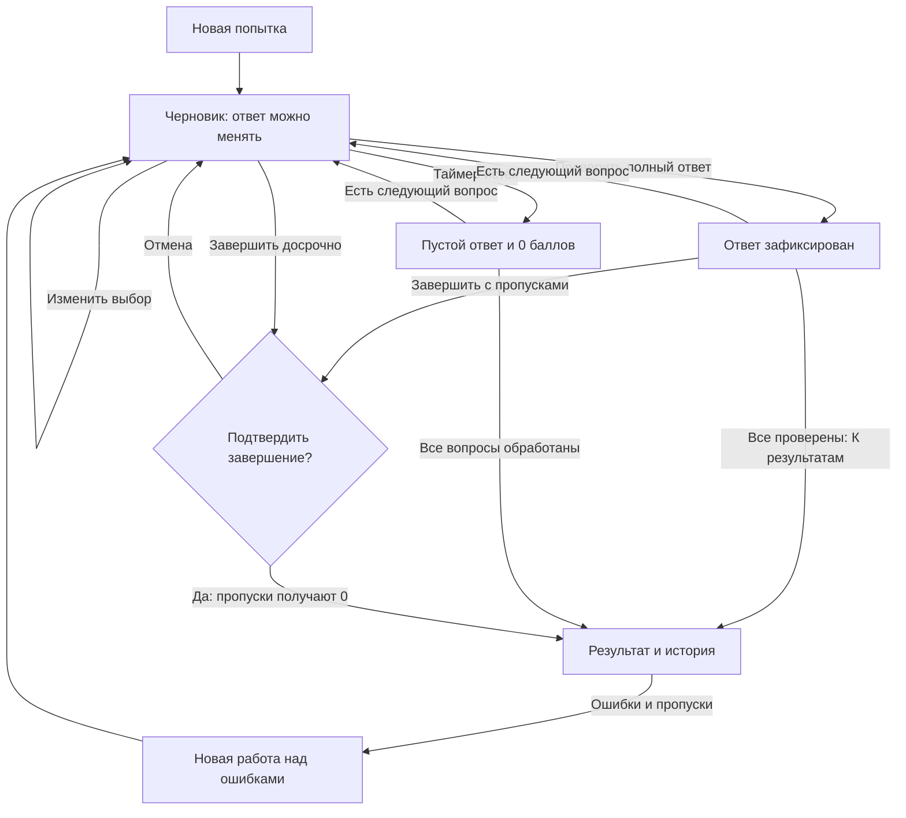
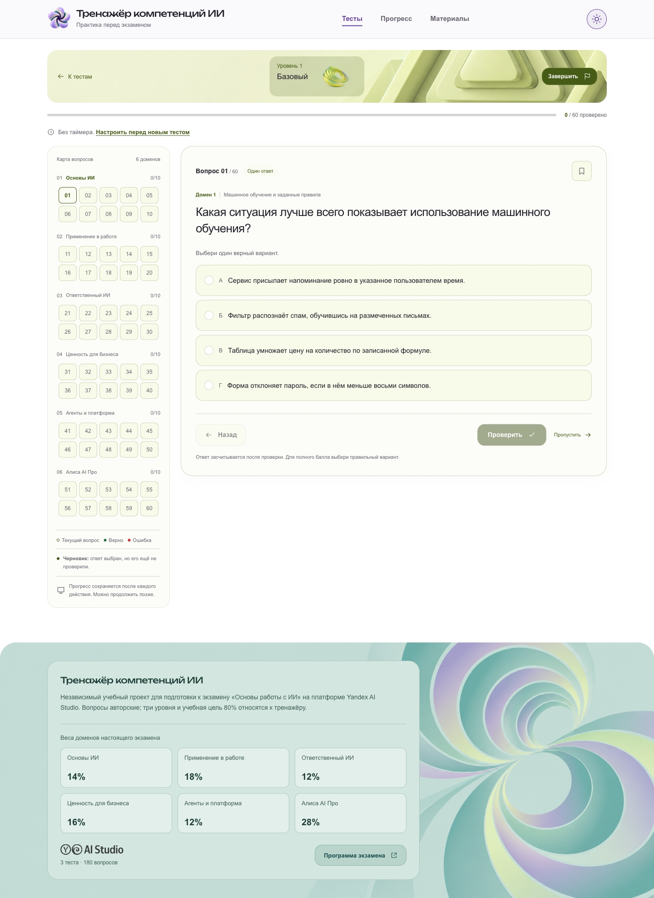
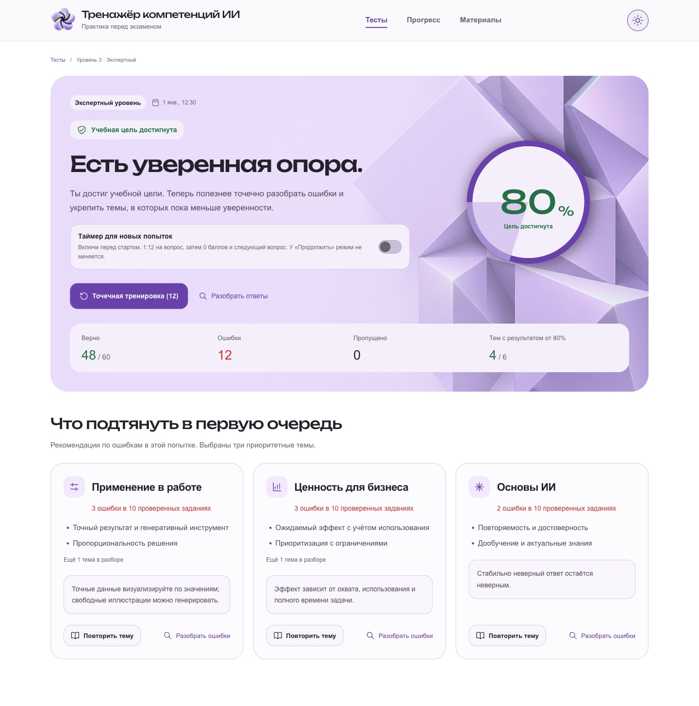
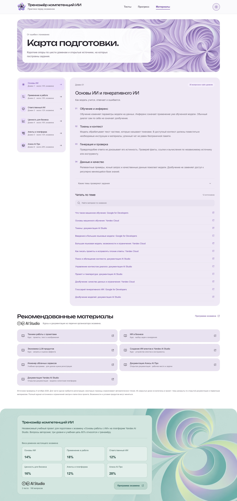
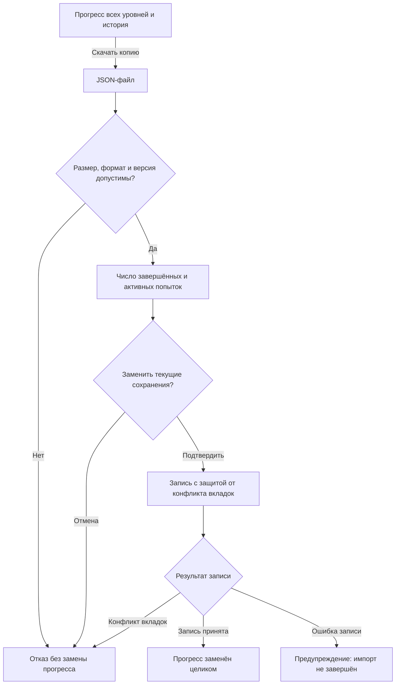

<p align="center">
  
</p>

#  Тренажёр компетенций ИИ

[](https://aistudio.yandex.ru/)
[](#банк-вопросов)
[](LICENSE)

**Практика перед экзаменом «Основы работы с ИИ» на платформе Yandex AI Studio.** Выберите уровень, ответьте на вопрос и разберите, почему ответ верен или ошибочен. Тренажёр сохраняет попытки, показывает темы для повторения и позволяет забрать свой прогресс с собой.

**180 авторских вопросов · 3 уровня сложности по 60 заданий · 6 доменов · русский язык · без регистрации.**

Тренажёр работает в современном браузере на компьютере, планшете и телефоне. Интерфейс подстраивается под размер экрана. На опубликованном сайте для прохождения тестов достаточно открыть ссылку, устанавливать приложение не нужно. Прогресс хранится в текущем браузере; для продолжения на другом устройстве перенесите [JSON-копию](#резервная-копия).

[Исходный репозиторий](https://github.com/ed-would/yandex-ai-studio-exam-lab) · [Программа экзамена](https://ai-basic-competencies.website.yandexcloud.net/) · [Помощь](SUPPORT.md) · [MIT](LICENSE)

Это **независимый учебный проект**. Он не создан и не одобрен Яндексом, не содержит официального банка экзамена, не выдаёт сертификаты и не гарантирует сдачу. Основа содержания: программа в редакции **4 октября 2026 года**. Ссылки текущего банка собраны в [индексе источников](docs/readme/SOURCES.md).

## Содержание

-  [Три уровня сложности](#три-уровня-сложности)
-  [Быстрый запуск](#быстрый-запуск)
-  [Знакомство с тренажёром](#знакомство-с-тренажёром)
-  [Банк вопросов](#банк-вопросов)
-  [Как проходить тест](#как-проходить-тест)
-  [Таймер и темп](#таймер-и-темп)
-  [Как считается результат](#как-считается-результат)
-  [Материалы для подготовки](#материалы-для-подготовки)
-  [Сохранения и перенос](#сохранения-и-перенос)
-  [Оформление и доступность](#оформление-и-доступность)
-  [Частые вопросы](#частые-вопросы)
-  [Участие и обратная связь](#участие-и-обратная-связь)
-  [Лицензия](#лицензия)

##  Три уровня сложности

В каждом уровне 60 вопросов. С каждым уровнем задания становятся сложнее.

| Уровень | Что проверяет | Вопросов |
| --- | --- | :---: |
| **1.&nbsp;Базовый** | Основные понятия ИИ и простые рабочие ситуации | 60 |
| **2.&nbsp;Продвинутый** | Выбор подхода, диагностику ошибок, работу с ограничениями | 60 |
| **3.&nbsp;Экспертный** | Ситуации с несколькими ограничениями: качество, данные, доступ и стоимость | 60 |

Рекомендуем проходить уровни по порядку: **Базовый, Продвинутый, Экспертный**. После каждого теста разберите ошибки, повторите слабые темы по материалам и закрепите их в новой попытке. Так вы переходите от понимания понятий к выбору решений и разбору сложных рабочих ситуаций. Все уровни доступны сразу; проходить предыдущий для открытия следующего не требуется.

##  Быстрый запуск

Нужны **Node.js не ниже 22.12** и npm.

```bash
git clone https://github.com/ed-would/yandex-ai-studio-exam-lab.git
cd yandex-ai-studio-exam-lab
npm ci
npm run dev
```

Откройте адрес из терминала, обычно **http://127.0.0.1:5173**. Если порт занят, Vite предложит другой. Остановить сервер можно сочетанием `Ctrl+C`. Для ZIP-архива: распакуйте его, откройте терминал в папке с `package.json` и начните с `npm ci`.

**Первый полезный результат:** на главной выберите любой уровень, нажмите «Начать тест», отметьте ответ и нажмите «Проверить». Появятся оценка, правильный вариант, объяснение и памятка.

`npm ci` устанавливает точные версии из `package-lock.json`; первой установке нужен доступ к npm. Для прохождения тестов не нужны API-ключи, аккаунт Яндекса, платная модель или сервер приложений. Внешние учебные статьи открываются отдельно и требуют интернета.

Сервер разработки по умолчанию слушает только `127.0.0.1`.

##  Знакомство с тренажёром

Тренажёр подходит для самостоятельной подготовки, повторения отдельных тем и проверки понимания рабочих ситуаций с ИИ.

<details>
<summary>Посмотреть главную страницу целиком, включая подвал</summary>

<picture>
  <source media="(prefers-color-scheme: dark)" srcset="assets/readme/screenshots/home-dark.jpg">
  
</picture>

Главная тренажёра до начала первой попытки. Снимок соответствует выбранной теме.

</details>

| Задача | Что сделать | Что получите |
| --- | --- | --- |
| Найти пробелы | Пройти полный тест выбранного уровня | Общий результат, карту доменов и темы для повторения |
| Разобраться в ошибке | Прочитать объяснение после проверки | Разбор каждого варианта или пары и ссылки на источники |
| Закрепить тему | Запустить работу над ошибками | Отдельную попытку по ошибочным и пропущенным заданиям |
| Проверить темп | Включить таймер перед новой попыткой | По 72 секунды на впервые открываемый вопрос |
| Продолжить позже | Вернуться к начатому уровню | Текущий вопрос, черновики, проверенные ответы и закладки |
| Перенести результаты | Скачать JSON в разделе «Прогресс» | Копию для восстановления в другом браузере или на устройстве |
| Сохранить разбор | Скачать HTML после завершения | Самостоятельный файл с ответами, объяснениями и источниками |

##  Банк вопросов

У каждого уровня свой набор. Наборы **фиксированы**: пересдача повторяет те же задания, переход на другой уровень открывает другие. Базовый обозначен лаймовым складчатым тором, продвинутый бирюзовыми арками со сферой, экспертный сиреневой треугольной лентой. Эти же формы используются в интерфейсе и на главном баннере.

### Шесть доменов

В каждом уровне на каждый домен приходится **ровно 10 заданий**. Программа настоящего экзамена задаёт другие доли: они нужны как ориентир при подготовке, но не меняют количество заданий в тренажёре.

| Домен | Название | Вопросов на уровень | Доля в программе |
| :---: | --- | :---: | :---: |
| 1 | Основы ИИ и генеративного ИИ | 10 | около 14% |
| 2 | Практическое применение в работе | 10 | около 18% |
| 3 | Ответственный ИИ | 10 | около 12% |
| 4 | Внедрение и ценность для бизнеса | 10 | около 16% |
| 5 | ИИ-агенты и инструменты агентской платформы | 10 | около 12% |
| 6 | Алиса AI Про для бизнеса: коннекторы, навыки и автоматизация | 10 | около 28% |

**3 уровня × 6 доменов × 10 заданий = 180 вопросов.** Равное покрытие помогает потренировать каждую область, включая темы с меньшей долей в программе.

### Три формата задания

<p>
<picture>
  <source media="(max-width: 600px) and (prefers-color-scheme: dark)" srcset="assets/readme/question-formats-v9/question-formats-mobile-dark.jpg">
  <source media="(max-width: 600px) and (prefers-color-scheme: light)" srcset="assets/readme/question-formats-v9/question-formats-mobile-light.jpg">
  <source media="(prefers-color-scheme: dark)" srcset="assets/readme/question-formats-v10/question-formats-desktop-dark.jpg">
  <source media="(prefers-color-scheme: light)" srcset="assets/readme/question-formats-v10/question-formats-desktop-light.jpg">
  
</picture>
</p>

Вид ответа меняется от задания к заданию. Таблица показывает, сколько раз каждый формат встречается в трёх тестах.

| Формат | Что требуется | Всего в банке |
| --- | --- | :---: |
| Один ответ | Выбрать один правильный вариант | 72 |
| Мультивыбор | Выбрать весь набор правильных утверждений | 72 |
| Сопоставление | Связать все элементы двух колонок | 36 |

В каждой группе «уровень × домен»: **4 одиночных + 4 множественных + 2 сопоставления**. Мультивыбор всегда содержит пять вариантов; правильным может быть любой непустой набор, включая один вариант или все пять.

Каждое задание содержит общий разбор, объяснение каждого варианта или пары, короткую памятку и прямые ссылки на первичные материалы. Вопросы авторские; закрытые официальные задания не воспроизводятся.

##  Как проходить тест

<picture>
  <source media="(max-width: 600px) and (prefers-color-scheme: dark)" srcset="assets/readme/learning-cycle-mobile-v8/learning-cycle-mobile-dark.jpg">
  <source media="(max-width: 600px) and (prefers-color-scheme: light)" srcset="assets/readme/learning-cycle-mobile-v8/learning-cycle-mobile-light.jpg">
  <source media="(prefers-color-scheme: dark)" srcset="assets/readme/learning-cycle-v7/learning-cycle-desktop-dark.jpg">
  <source media="(prefers-color-scheme: light)" srcset="assets/readme/learning-cycle-v7/learning-cycle-desktop-light.jpg">
  
</picture>

1. **Выберите уровень.** При необходимости включите таймер до начала попытки.
2. **Сформируйте ответ.** Один вариант, несколько утверждений или все пары сопоставления. Пока ответ не проверен, это черновик.
3. **Нажмите «Проверить».** Тренажёр зафиксирует ответ, покажет правильный результат, объяснение и памятку.
4. **Разберите причину.** Подробное пояснение рассматривает каждый вариант или пару. Ссылки внизу задания ведут к дополнительному чтению.
5. **Продолжайте в своём порядке.** Карта вопросов позволяет переходить между заданиями; закладки отмечают вопросы для возвращения.
6. **После завершения повторите ошибки.** Можно открыть отдельную тренировку, пересдать весь уровень или перейти к другому.

**Проверенный ответ изменить нельзя**, в том числе после возвращения назад или обновления страницы. Новую оценку даёт новая попытка. Если выйти на главную, незавершённая попытка сохраняется для продолжения при доступном хранилище.

При досрочном завершении приложение просит подтверждение. Непроверенные задания получают **0 баллов**, даже если в них уже заполнен черновик.


<details>
<summary>Как связаны черновик, проверка, таймер и результат</summary>



Правила начисления баллов описаны в разделе [«Как считается результат»](#как-считается-результат), условия отсчёта и автоматического завершения в разделе [«Таймер и темп»](#таймер-и-темп).

</details>

### Сопоставление без перетаскивания

На широком экране нажмите элемент одной колонки, затем другой. Начинать можно с любой стороны. Новая связь освобождает занятый элемент от прежней пары. Повторный выбор той же пары разрывает связь; крестик удаляет одну пару, «Сбросить связи» удаляет все пары текущего вопроса. Кнопка «Проверить» доступна после заполнения всех связей.

На узком экране для каждого термина выберите соответствие в списке. Чтобы удалить пару, выберите «Без соответствия»; выбранное соответствие освобождается от прежней пары. Проверка доступна после заполнения всех списков.

### Пример из настоящего банка

Задание `L1-D1-Q01`, базовый уровень, домен «Основы ИИ»:

> **Какая ситуация лучше всего показывает использование машинного обучения?**
>
> - А. Сервис присылает напоминание ровно в указанное пользователем время.
> - Б. Фильтр распознаёт спам, обучившись на размеченных письмах.
> - В. Таблица умножает цену на количество по записанной формуле.
> - Г. Форма отклоняет пароль, если в нём меньше восьми символов.

<details>
<summary>Правильный ответ и объяснение</summary>

**Б.** Фильтр вывел закономерности из примеров и применяет их к новым данным. Расписание, формула и проверка длины пароля в остальных вариантах заданы готовыми правилами.

Памятка из задания: **«Ищите обучение на примерах, а не только автоматическое выполнение действий».** Полный текст и ссылки находятся в [банке первого домена](src/data/domain-1.json).

</details>

<details>
<summary>Посмотреть экран экспертного задания (уровень 3) в обеих темах</summary>

<picture>
  <source media="(prefers-color-scheme: dark)" srcset="assets/readme/screenshots/question-dark.jpg">
  
</picture>

Снимки показывают первый вопрос экспертного уровня в светлой и тёмной темах. Кадр заканчивается перед подвалом.

</details>

##  Таймер и темп

По умолчанию ограничений времени нет. Переключатель **«Таймер для новых попыток»** находится над уровнями и на экране результата. Он применяется к новой полной попытке и работе над ошибками. Продолженная попытка сохраняет свой прежний режим; включить отсчёт посреди начатого теста нельзя.

С таймером на каждый вопрос даётся **72 секунды, или 1:12**. Это учебный ориентир: 60 минут × 60 секунд / 50 вопросов. Для 60 заданий тренажёра сумма таких интервалов составляет 72 минуты, но это **отдельные сроки вопросов**, а не один общий таймер на весь тест.

| Событие | Поведение |
| --- | --- |
| Первый переход к вопросу | Начинается его собственный отсчёт |
| Ответ проверен до срока | Ответ засчитывается; открывается разбор |
| До конца осталось 10 секунд | Появляется подпись «Время истекает» и красное выделение |
| Срок истёк | Черновик удаляется, фиксируется 0 баллов и «Время вышло» |
| После истечения срока остались вопросы без ответа | Тренажёр переходит к следующему |
| Истёк срок последнего незавершённого вопроса | Итог открывается автоматически |
| Последний незавершённый вопрос проверен вручную | Остаётся разбор; итог откройте кнопкой «К результатам» на последнем вопросе теста |

У посещённого вопроса время продолжает идти при переходе по карте, выходе из теста и обновлении страницы. Возвращение не выдаёт новые 72 секунды. **Ещё не открытые вопросы не теряют время.** Разбор просроченного вопроса остаётся доступным.

Это тренировка темпа на фиксированных наборах, а не точная симуляция всех правил официального экзамена.

##  Как считается результат

За полностью правильное задание начисляется **1 балл**, за ошибку или пропуск **0 баллов**. Частичного зачёта нет: в мультивыборе должен совпасть весь набор, в сопоставлении все пары. В полном тесте каждое из 60 заданий имеет одинаковый вес.

```text
Основной процент = правильные ответы / все задания × 100
47 / 60 × 100 = 78,3%
48 / 60 × 100 = 80%
```

Процент округляется до десятых; у целого значения дробная часть не показывается. **80% служит учебной целью проекта, а не официальным проходным баллом.**

В раскрываемом пояснении полного результата доступен дополнительный ориентир: доля правильных ответов в каждом домене умножается на его вес в программе, затем доли складываются. Веса: 14, 18, 12, 16, 12 и 28%. Этот ориентир не заменяет основной процент и не прогнозирует официальную оценку.

### Результат, разбор и следующий шаг

<details>
<summary>Посмотреть результат экспертного уровня в обеих темах</summary>

<picture>
  <source media="(prefers-color-scheme: dark)" srcset="assets/readme/screenshots/results-dark.jpg">
  
</picture>

Учебный пример экспертного уровня: 48 правильных ответов, 12 ошибок, 0 пропусков. Данные демонстрационные. Кадр показывает итог и рекомендации, заканчивается до разбора заданий и подвала.

</details>

После завершения доступны общий итог, показатели шести доменов, приоритетные темы для повторения и план подготовки. В разборе можно отфильтровать ошибки, пропуски, правильные ответы, закладки и конкретный домен. Рекомендации различают ошибочный ответ и ещё не проверенную тему.

Результаты полного уровня и работы над ошибками хранятся отдельно. Повторение ошибочных и пропущенных заданий **не повышает лучший балл полного теста**. Для сопоставимого результата нужно заново пройти весь уровень.

### HTML-разбор и печать

Кнопка скачивания создаёт самостоятельный HTML-файл с разбором одной выбранной попытки: ваши ответы, правильные варианты, объяснения каждой пары или утверждения, памятки и ссылки. Он сохраняет выбранную тему и открывается отдельно от приложения; для печати используется светлое оформление. Внешние источники внутри файла по-прежнему требуют интернета.

JSON-копия и HTML-разбор решают разные задачи: **JSON переносит прогресс**, **HTML сохраняет читаемый разбор**. Импорт HTML в тренажёр не предусмотрен.

##  Материалы для подготовки

В разделе «Материалы» собраны короткие опоры по шести доменам, темы заданий, поиск и фильтрация источников. Отсюда можно перейти к первичным материалам и семи официальным рекомендациям программы.

<details>
<summary>Посмотреть материалы без подвала в обеих темах</summary>

<picture>
  <source media="(prefers-color-scheme: dark)" srcset="assets/readme/screenshots/materials-dark.jpg">
  
</picture>

Экран материалов работающего приложения от верхней панели до конца основного содержимого; подвал не включён.

</details>

Материалы помогают объяснить принцип своими словами, затем проверить его на задании. Внешние страницы и курсы принадлежат их правообладателям; в проекте находятся ссылки и самостоятельные объяснения, а не копии курсов.

В [списке источников](docs/readme/SOURCES.md) можно посмотреть, на какие материалы опираются вопросы и где используются ссылки.

##  Сохранения и перенос

В обычном режиме прогресс находится на устройстве в `localStorage` браузера. Учётной записи, серверной базы и автоматической синхронизации между устройствами нет. Сохраняются незавершённые попытки, позиция, черновики, связи, закладки, проверенные ответы и история результатов.

Раздел **«Прогресс»** показывает лучшие и последние результаты каждого уровня, историю и динамику последних попыток. У работы над ошибками своя история.

### Резервная копия

1. В «Прогрессе» скачайте JSON-копию.
2. Откройте тренажёр на другом устройстве или в другом браузере.
3. Выберите восстановление из файла и подтвердите замену.

**Импорт заменяет текущие сохранения**, поэтому перед восстановлением скачайте копию имеющихся данных. Приложение проверяет структуру, версию банка и состав ответов, затем заново рассчитывает оценку. Чужой флаг «верно» и сохранённый процент не считаются доказательством правильного ответа.

Можно очистить один уровень или весь прогресс. Очистка требует подтверждения и удаляет также соответствующие незавершённые попытки. После очистки браузера, смены адреса или приватного сеанса долговечность результатов не гарантирована.


<details>
<summary>Как JSON-копия проходит проверку и заменяет прогресс</summary>



Файл должен быть не больше **10 МиБ (10 485 760 байт)**. До подтверждения проверяются JSON, идентификатор приложения, версия схемы и банка, состав попыток, ответов и таймеров. Корректность ответов пересчитывается по текущим вопросам. Неверный файл отклоняется; автоматического объединения и переноса между несовместимыми банками нет.

После подтверждения импорт заменяет все уровни и оба режима. Конфликт вкладок или непринятая запись останавливают восстановление и вызывают предупреждение. В режиме временного хранения импорт сохраняет восстановленные данные в `sessionStorage`, если запись в него доступна. Перед восстановлением скачайте нынешний прогресс; временно восстановленные данные сохраните отдельным JSON.

</details>

### Адрес тоже имеет значение

`localhost` и `127.0.0.1`, разные порты, другой браузер и разные пути проекта имеют отдельные сохранения. Локальная и опубликованная версии также имеют отдельные сохранения. Для переноса используйте JSON.

### Если запись недоступна

| Состояние | Где остаётся текущий прогресс | Что делать |
| --- | --- | --- |
| Постоянное хранилище и Web Locks доступны | `localStorage`, с защитой записи между вкладками | Продолжать и периодически скачивать копию |
| Нет Web Locks, запись запрещена, запись старая или повреждена | Отдельная копия в `sessionStorage`, если оно доступно | Скачать JSON перед закрытием вкладки |
| Недоступно и хранилище вкладки | Только память открытой страницы | Скачать JSON до обновления или закрытия |
| Прогресс изменён в другой вкладке | Показано предупреждение о конфликте | Загрузить актуальные данные перед продолжением |

Приложение сообщает о проблеме и **не перезаписывает повреждённые или несовместимые данные молча**. Временная копия в `sessionStorage` переживает обновление этой вкладки. Успешная запись в постоянное хранилище удаляет временную копию, в том числе при очистке или импорте. Изменение исходных данных в другой вкладке делает её недействительной.

JSON содержит весь сохранённый прогресс и историю. Храните резервные копии как свои учебные данные; для сообщения об ошибке лучше использовать искусственный пример.

##  Оформление и доступность

Солнце и луна в шапке переключают светлую и тёмную темы. При первом открытии применяется тема системы, затем выбор сохраняется отдельно от результатов и синхронизируется между вкладками. Переключение не сбрасывает текущий вопрос или черновик. Анимации учитывают `prefers-reduced-motion`.

Вопросы имеют текстовые статусы и видимые состояния выбора; оценка не должна считываться только по цвету. Есть ссылка «Перейти к содержимому», видимые фокусы, клавиатурное управление сопоставлением, поиск и фильтры. Модальное окно удерживает фокус и возвращает его после закрытия; доступна печать результата.

##  Частые вопросы

<details>
<summary>Это официальный тренажёр Яндекса?</summary>

Нет. Это независимый проект по опубликованной программе. Авторские вопросы, уровни и цель 80% относятся к тренажёру. По регистрации на настоящий экзамен и сертификатам обращайтесь к владельцу платформы.

</details>

<details>
<summary>Нужны платная подписка, модель или API-ключ?</summary>

Для тренажёра нет. Проверка выполняется локально в браузере. Отдельные внешние учебные сервисы могут иметь собственные условия доступа.

</details>

<details>
<summary>Можно работать без интернета?</summary>

После установки зависимостей локальный сервер обслуживает код, банк, изображения и шрифты с вашего компьютера. Для заданий обращения к модели или CDN не нужны. Первоначальная установка npm и чтение внешних источников требуют сети. Автономное кэширование опубликованного сайта как PWA не заявлено.

</details>

<details>
<summary>Почему исчез прогресс?</summary>

Проверьте браузер, адрес, порт и путь проекта. Они определяют отдельное хранилище. Прогресс также теряется после очистки браузера или закрытия вкладки, если приложение работало только в памяти или `sessionStorage`. Восстановите свою JSON-копию; серверной копии у автора нет.

</details>

<details>
<summary>Почему восстановление файла отклонено?</summary>

Возможны повреждённая структура, несовместимая версия банка или недопустимые ответы. JSON-копия тренажёра и HTML-разбор не взаимозаменяемы. При обращении за помощью укажите текст ошибки и искусственный пример; не публикуйте личную историю.

</details>

<details>
<summary>Почему порт занят или npm ci не запускается?</summary>

Проверьте версию Node.js, доступ к npm и наличие `package-lock.json`. Для локального запуска используйте адрес, напечатанный Vite. Дополнительные команды описаны в [документации для разработчиков](docs/DEVELOPMENT.md).

</details>

<details>
<summary>Почему ответ нельзя исправить и почему нет частичных баллов?</summary>

Первое нажатие «Проверить» фиксирует результат текущего ответа. Изменить оценку можно в новой попытке. Условия полного зачёта описаны в разделе [«Как считается результат»](#как-считается-результат).

</details>

<details>
<summary>Какой браузер использовать?</summary>

Проект рассчитан на современные браузеры с поддержкой модулей и возможностей, используемых Vite. Для постоянного сохранения нужны доступное хранилище, Web Locks и HTTPS или localhost.

</details>

##  Участие и обратная связь

Ошибки приложения, неточности заданий, предложения и вопросы принимаются через [формы GitHub Issues](https://github.com/ed-would/yandex-ai-studio-exam-lab/issues/new/choose).

Для сбоя укажите браузер, ОС, адрес или способ размещения, шаги воспроизведения и текст ошибки. Для вопроса из банка добавьте его ID, уровень, спорную формулировку и первичный источник. Личные копии, токены и чувствительные данные заменяйте искусственными примерами.

Порядок внесения изменений описан в [CONTRIBUTING.md](CONTRIBUTING.md), правила общения в [CODE_OF_CONDUCT.md](CODE_OF_CONDUCT.md), маршруты помощи в [SUPPORT.md](SUPPORT.md). О потенциальной уязвимости сообщайте **приватно по [SECURITY.md](SECURITY.md)**. Проект поддерживается добровольно; сроки ответа и исправления не гарантированы.

##  Лицензия

Автор: [Ed Would](https://github.com/ed-would). Авторский код, вопросы, объяснения и собственная графика распространяются по [MIT](LICENSE): проект можно запускать, изменять, распространять и использовать коммерчески с сохранением уведомления об авторских правах и текста лицензии.

| Материал | Условия |
| --- | --- |
| Авторский код, банк и собственная графика | [MIT проекта](LICENSE) |
| Шрифт Unbounded | [SIL Open Font License 1.1](public/fonts/Unbounded-OFL.txt) |
| Иконки Lucide в README | [ISC](assets/readme/icons/LICENSE) |
| Включённые зависимости | Лицензии формируются Vite в `dist/.vite/license.md` |
| Обозначения продуктов и брендовые материалы Яндекса | Принадлежат правообладателям; MIT проекта на них не распространяется |
| Внешние статьи и курсы | Условия соответствующих правообладателей; в проекте только ссылки |
