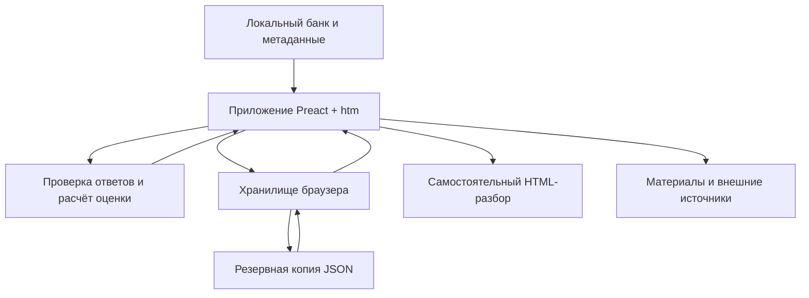

# Разработка и сопровождение

Этот документ предназначен для разработчиков и сопровождающих проекта. Пользовательский запуск, прохождение тестов, оценка, сохранения и материалы описаны в [README](../README.md).

## Стек и устройство

Стек: **Preact + htm + Vite**, обычные JavaScript и CSS. Вопросы и ответы включены в приложение как локальные данные. Проверка и расчёт выполняются в браузере; собственный сервер API не нужен. `happy-dom` используется только для тестов и не входит в браузерную сборку.



Приложение читает банк, передаёт ответ в логику проверки и показывает рассчитанный результат. Состояние попыток сохраняется на устройстве; JSON выносит и восстанавливает это состояние. HTML создаётся отдельно для чтения и печати. Внешние источники открываются по ссылкам и не участвуют в локальном подсчёте.

### Карта исходников

| Путь | Назначение |
| --- | --- |
| [src/main.js](../src/main.js), [src/app.js](../src/app.js) | Запуск, маршруты, состояние и пользовательские действия |
| [src/data/bank.js](../src/data/bank.js) | Сборка шести доменов в общий банк |
| [src/data/meta.js](../src/data/meta.js) | Уровни, домены, веса, памятки, даты и версия банка |
| `src/data/domain-1.json` … `domain-6.json` | Вопросы, ключи, объяснения и источники |
| [src/core/exam.js](../src/core/exam.js) | Попытки, черновики, таймер и оценка |
| [src/core/coaching.js](../src/core/coaching.js) | Приоритетные темы и рекомендации результата |
| [src/core/storage.js](../src/core/storage.js) | Хранилища, резервные копии и защита сохранений |
| [src/core/report.js](../src/core/report.js) | Самостоятельный HTML-разбор |
| [src/core/theme.js](../src/core/theme.js) | Настройка темы и связь с интерфейсом |
| [src/components](../src/components) | Экраны, вопросы, сопоставление, фильтры и элементы интерфейса |
| [src/dev](../src/dev) | Изолированные сценарии результата |
| [src/styles.css](../src/styles.css), [src/theme.css](../src/theme.css) | Геометрия, типографика, оформление и ночные переопределения |
| [public/theme-controls.css](../public/theme-controls.css) | Общие `--ui-*`, примитивы уровней и семантические токены |
| [public](../public) | Ресурсы сайта, тема, иконка, локальные шрифты и `.nojekyll` |
| [tests](../tests) | Логика, взаимодействия, тема, зависимости и макеты |
| [scripts](../scripts) | Валидатор банка и оптимизация изображений |
| [docs/design-lab](design-lab) | Исходники, концепты, референсы и промпты оформления |
| [assets/readme](../assets/readme) | Графика README, снимки, источники композиций и лицензии |
| [vite.config.js](../vite.config.js) | Относительный `base` и список ресурсов production-сборки |
| `dist/` | Результат сборки, исключён из Git |

Hash-маршруты, например `#/exam/1`, позволяют разместить приложение в подпапке статического хостинга. Серверу не нужно настраивать отдельные маршруты экранов.

## Команды

| Команда | Назначение |
| --- | --- |
| `npm ci` | Установка точных версий зависимостей |
| `npm run dev` | Локальная разработка, обычно порт 5173 |
| `npm run dev:results` | Изолированные макеты результатов, порт 4178 |
| `npm run build` | Проверка банка и сборка в `dist` |
| `npm run check` | Линтеры, форматирование, валидатор банка, тесты и production-сборка |

### Изолированные сценарии результатов

Для проверки интерфейса без прохождения 60 вопросов:

```bash
npm run dev:results
```

Откройте **http://127.0.0.1:4178**. Панель позволяет выбирать уровень и сценарий: состояния вокруг границ **60/80/95%**, идеальный и ошибочный результат, пустую и досрочную попытку, а также работу над ошибками. Доступны обе темы, разбор, фильтры, история и экспорт.

Макеты живут только в памяти: обычные сохранения не читаются и не изменяются. Перезагрузка и смена сценария восстанавливают макеты; выбранный сценарий остаётся в адресе. Панель не входит в обычную production-сборку. Если порт занят, задайте другой:

```bash
npm run dev:results -- --port 4179
```

Для настоящей подготовки используйте `npm run dev`; показанный макетом процент не является результатом ученика.

### Локальная сеть

Сервер разработки по умолчанию слушает только `127.0.0.1`. Для осознанного доступа с другого устройства в локальной сети:

```bash
npm run dev -- --host 0.0.0.0
```

На обычном HTTP-адресе локальной сети браузер может не предоставлять Web Locks. В таком случае прогресс сохраняется временно в этой вкладке, а не в постоянном хранилище; перед закрытием скачайте JSON-копию. Для долговечного сохранения используйте HTTPS или localhost.

## Обновление вопросов

Сначала прочитайте [CONTENT_CONTRACT.md](CONTENT_CONTRACT.md) и исследование нужного домена. Каждому вопросу нужны однозначный ключ, объяснения всех вариантов или пар, памятка и прямые первичные источники. Следующий уровень должен проверять дополнительные условия и рассуждение.

| Домен | Исследование |
| --- | --- |
| 1. Основы ИИ | [research-domain-1.md](research-domain-1.md) |
| 2. Применение в работе | [research-domain-2.md](research-domain-2.md) |
| 3. Ответственный ИИ | [research-domain-3.md](research-domain-3.md) |
| 4. Ценность для бизнеса | [research-domain-4.md](research-domain-4.md) |
| 5. Агенты и платформа | [research-domain-5.md](research-domain-5.md) |
| 6. Алиса AI Про | [research-domain-6.md](research-domain-6.md) |

После изменений выполните `npm run check`. Валидатор доказывает соблюдение структуры и количеств, но не истинность каждого утверждения: содержательную корректность проверяет редактор.

Текущая версия банка: **`2026-10-09.2`**. При изменении смысла вопроса или правильного ответа обновите `BANK_VERSION` и продумайте перенос истории. Проверка версии защищает от несовместимого импорта; автоматической миграции между разными банками нет.

Реальные тарифы и быстро меняющиеся числовые лимиты в вопросах не закрепляются. Если для расчёта нужны числа, они должны быть явно заданы как учебные условия.

## Графика README

### Цвета сайта

| Роль | Светлая тема | Тёмная тема |
| --- | --- | --- |
| Общие ссылки и основные действия | Экспертный фиолетовый `#6841AB` | Составной градиент лайма, мяты и сирени |
| Содержимое уровня | Собственная палитра теста | Соответствующая ночная палитра |
| Материалы и учебные блоки | Сиреневые учебные акценты | Сиреневые учебные акценты |
| Подвал | Отдельная серо-зелёная палитра | Отдельная серо-зелёная палитра |
| Плашка Yandex AI Studio | Только `#004C59` | Тот же `#004C59` |

Полный контракт цветов, типографики, компонентов и обеих тем находится в [DESIGN.md](../DESIGN.md). Runtime-токены изменяйте по этому контракту.

### Исходники композиций

Происхождение композиций, исходники, промпты, шрифты, проверки и порядок замены описаны в [assets/readme/ASSETS.md](../assets/readme/ASSETS.md). Графика README создаётся встроенным Image Generation и хранится в репозитории; при замене сцены сохраняйте соответствующие макет, исходный растровый файл, итоговые экспорты, проверки и запись в манифесте.

Заголовки макетов набраны локальным **Unbounded**, основной текст **Arial**, как на сайте. Кириллица и латиница Unbounded хранятся в `public/fonts`; внешние шрифты и CDN не требуются. Для точной типографики макеты загружают оба WOFF2. Перед обновлением баннера проверьте его при фактической ширине README, в светлой и тёмной темах, а также на узком экране, если у композиции есть мобильная версия.
